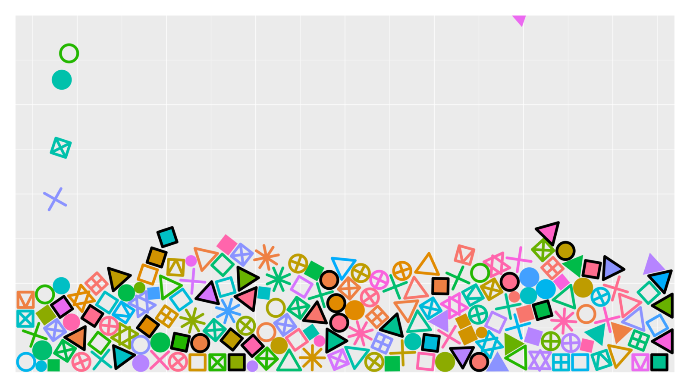
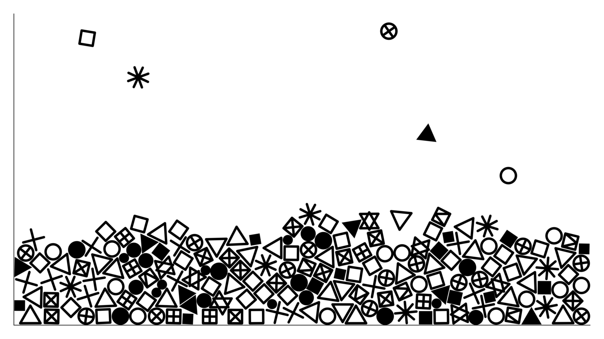
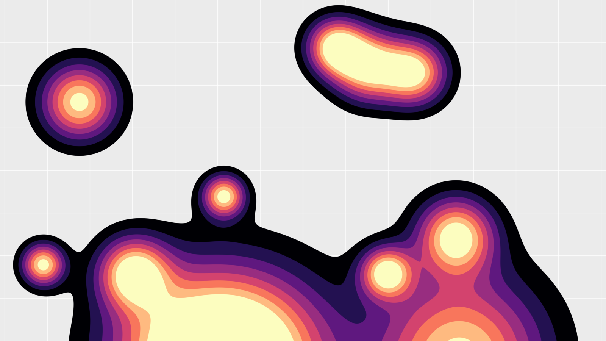
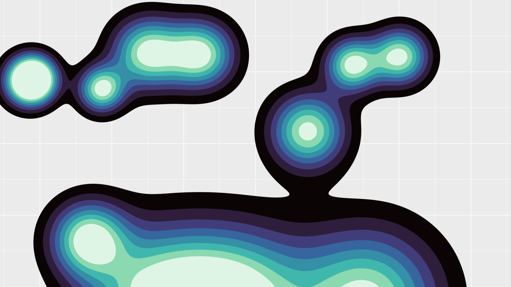

# gg.saver

macOS screensaver with two ggplot2-styled scenes.

- **Shape fall.** The 26 `pch` shapes fall into the panel, pile up and drain through the floor. Physics: SpriteKit, one body per shape outline.

   

- **Lava lamp.** `geom_density_2d_filled()` of moving Gaussian blobs, drawn by a shader. The lowest band is transparent.

   

## Options

- **Shape fall**
  - Theme: `theme_grey()`, `theme_bw()`, `theme_classic()`.
  - Colour: black, or random from `hue_pal()`.
  - Fill time: 15 s, 30 s, 1 min, 2 min.
- **Lava lamp**
  - Palette: viridis, magma, plasma, mako, turbo (`viridisLite::viridis(8, option = …)`).

## Install

Requires macOS 14+. Download from the [latest release](https://github.com/gkaramanis/gg-saver/releases/latest):

- `gg.saver-<version>.pkg`: open it and follow the installer. Choose this Mac or only your account.
- `gg.saver-<version>.zip`: unzip and double-click `gg.saver.saver`.

Then choose gg.saver in System Settings → Screen Saver. Options are under the Options button there.

## Build

Requires macOS 14+ and the Xcode command line tools.

```sh
./build.sh          # build/gg.saver.saver, ad hoc signed
./build.sh install  # build and install for the current user
./build.sh release  # Developer ID signed, notarized zip
./build.sh pkg      # release, plus a signed, notarized installer
```

Notarizing uses the keychain profile in `NOTARY_PROFILE` (default `stripes-notary`). The version comes from `CFBundleShortVersionString` in `GGSaver/Info.plist`. `tools/thumbnail.sh` redraws the System Settings thumbnail.

Reopen System Settings after reinstalling if it shows the old version.
